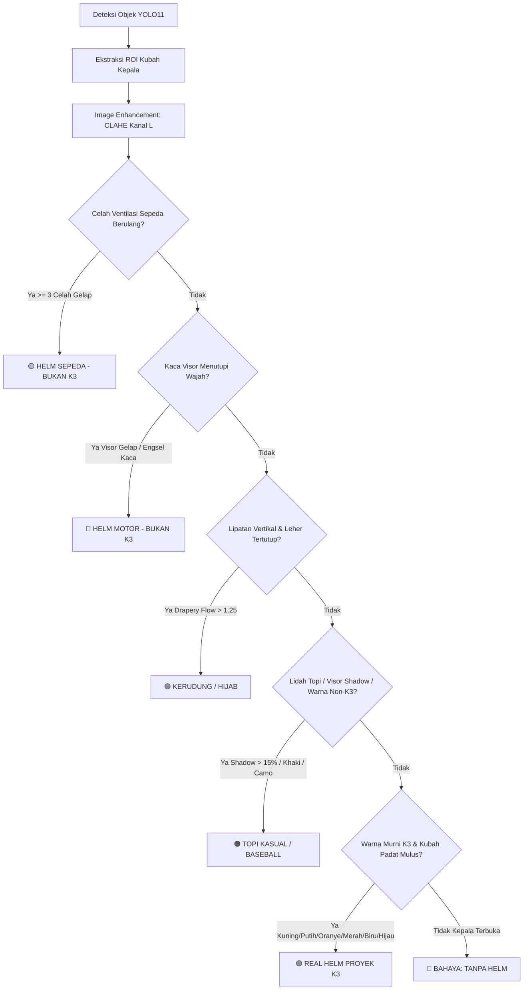

# 🦺 Sistem Cerdas Deteksi K3 Helm Proyek (Real-Time Helmet Surveillance)
### Integrasi Deep Learning (YOLO11) & Pengolahan Citra Digital (Slide P01 - P15 Universitas Bina Sarana Informatika)

---

## 📌 Ringkasan Eksekutif & Latar Belakang Proyek

Dalam standar Keselamatan dan Kesehatan Kerja (K3) sektor konstruksi dan industri manufaktur (berdasarkan regulasi OSHA & Permenakertrans), penggunaan **Helm Pelindung Kepala Proyek (Safety Helmet / Hardhat)** bersifat wajib mutlak.

Banyak sistem deteksi objek standar (black-box YOLO) gagal di lapangan karena bias data:
1. **Topi Kasual / Baseball Cap**: Sering dikira helm oleh model standar karena letaknya di atas kepala.
2. **Helm Motor (Full Face / Half Face)**: Meskipun helm pelindung jalan raya, helm motor **dilarang di area proyek K3** karena cangkangnya yang tebal menutupi telinga/pipi sehingga membatasi mobilitas, sudut pandang samping (*peripheral vision*), dan pendengaran instruksi darurat pekerja.
3. **Helm Sepeda (Bicycle Helmet)**: Didesain untuk aerodinamika berkendara sepeda dengan pori-pori ventilasi berulang, **tidak tahan terhadap impak benturan vertikal material jatuh** dari ketinggian proyek.
4. **Kerudung / Hijab**: Pekerja muslimah yang mengenakan kerudung tetap **wajib mengenakan helm proyek K3 di luar kerudungnya** saat berada di zona bahaya proyek.
5. **Tanpa Helm (Kepala Terbuka)**: Pelanggaran kritis K3 yang membahayakan jiwa pekerja.

Proyek ini menghadirkan **Multi-Stage Verification System**:
Menggabungkan kecepatan lokalisasi objek dari **YOLO11** dengan kekuatan verifikasi fisik berbasis **Pengolahan Citra Digital Klasik** (sesuai silabus perkuliahan Slide P01–P11 BSI) untuk memastikan objek yang dikenakan adalah **Helm Proyek K3 Resmi**, bukan topi biasa, helm motor, helm sepeda, ataupun kerudung.

---

## 🎓 Korelasi Ilmiah dengan Materi Slide Kuliah Pengolahan Citra (BSI)

| Slide Kuliah | Topik Materi | Implementasi Nyata pada Proyek Ini |
| :--- | :--- | :--- |
| **Slide P01** | *Pengenalan Pengolahan Citra & Rancangan Proyek* | Penerapan *Project-Based Learning* untuk menyelesaikan masalah dunia nyata (Sistem Pengawasan K3 Cerdas). |
| **Slide P02** | *Spatial Filtering (Konvolusi Kernel)* | Penerapan **Gaussian Blur** ($5 \times 5$, $\sigma=1.0$) untuk mereduksi noise sensor kamera sebelum ekstraksi gradien tepi. |
| **Slide P03** | *Peningkatan Kualitas Citra (Image Enhancement)* | Menerapkan **CLAHE (Contrast Limited Adaptive Histogram Equalization)** pada kanal *Luminance* (ruang warna LAB) untuk menormalkan pencahayaan ekstrem di area konstruksi (terik matahari & bayangan tajam). |
| **Slide P04** | *Model Warna (Color Models - RGB vs HSV)* | 1. **Evaluasi Zona Kubah (Crown Top 60%):** Memfokuskan evaluasi pada kubah kepala agar tidak terpengaruh warna kulit dahi/wajah.<br>2. **Palet Warna Murni K3:** Kuning, Putih Seimbang ($|R-B| \le 22$), Oranye, Merah Jenuh ($S \ge 120$), Biru, dan Hijau.<br>3. Membedakan topi krem/khaki ($R \gg B$), kain camo, dan visor kaca helm motor. |
| **Slide P05** | *Pemugaran Citra (Image Restoration)* | Mereduksi distorsi artefak pencahayaan dan pantulan kilau material. |
| **Slide P07** | *Pendeteksian Tepi (Edge Detection - Canny & Sobel)* | 1. **Deteksi Bayangan Visor Topi ($V_{upper}$ vs $V_{lower}$):** Lidah topi menimbulkan bayangan gelap tajam di bawahnya ($> 15\%$).<br>2. **Deteksi Kaca Helm Motor:** Garis horizontal engsel kaca dan pita visor gelap ($V < 45$).<br>3. **Deteksi Pori Ventilasi Sepeda:** Kontur tertutup celah berongga yang gelap di dalamnya.<br>4. **Sobel Y vs X (Drapery Flow):** Lipatan kain vertikal kerudung ($G_y / G_x > 1.25$). |
| **Slide P09 & P11** | *Segmentasi & Morfologi Citra* | **Opening:** Membersihkan noise rambut.<br>**Closing:** Menutup lubang akibat pantulan kilau cahaya (*specular sheen*) pada kubah plastik helm.<br>**Simetri Geometri:** Mendeteksi asimetri lidah topi (*visor*) vs kubah melingkar helm safety. |
| **Slide P12-15** | *Presentasi Kelompok* | Dilengkapi antarmuka Web Dashboard dengan live visualizer tahapan pengolahan citra untuk demonstrasi di depan dosen penguji. |

---

## 🔬 Matriks Pembeda Fisik: 6 Kategori Penutup Kepala



| Kategori | Ciri-Ciri Citra Digital (Slide P02-P11) | Status K3 |
| :--- | :--- | :--- |
| 🟢 **Helm Proyek Resmi (K3)** | Kubah plastik padat mulus, warna resmi K3 (Kuning, Putih seimbang, Merah, Biru, Hijau, Oranye), telinga terbuka, tanpa visor kaca motor / ventilasi sepeda. | **AMAN (Compliant)** |
| 🟠 **Topi Kasual / Baseball** | Memiliki lidah visor melengkung yang menimbulkan bayangan kontras di bawahnya, kain twill/khaki/camo ($R \gg B$), variansi hue tinggi. | **PELANGGARAN (Violation)** |
| 🔵 **Helm Motor (Full/Half Face)** | Memiliki kaca visor (face shield) melintang di depan mata/wajah, cangkang tebal membungkus telinga dan rahang. Membatasi visibilitas dan pendengaran K3. | **PELANGGARAN (Violation)** |
| 🟡 **Helm Sepeda Aerodinamis** | Memiliki $\ge 3$ pori-pori ventilasi aerodinamis berulang memanjang pada kubah atas. Tidak tahan terhadap benturan benda jatuh vertikal K3. | **PELANGGARAN (Violation)** |
| 🟣 **Kerudung / Hijab** | Kain berlipat vertikal (*drapery flow* $G_y > G_x$) yang menjulur menutupi leher dan pundak. Wajib dilengkapi helm proyek K3 di luarnya. | **PERINGATAN (Violation)** |
| 🔴 **Tanpa Helm** | Rambut dan kulit kepala terbuka tanpa pelindung di area wajib K3. | **BAHAYA (Danger)** |

---

## 🚀 Panduan Menjalankan Aplikasi (*Ready to Deploy*)

### Cara Cepat (1-Klik di Windows):
Klik ganda file:
```
run.bat
```
Pilih opsi **[1]** untuk membuka Web Dashboard interaktif.

---

### Cara Manual via Terminal:
```bash
python run_web.py
```
Akses di browser:
👉 **`http://127.0.0.1:8000`**

- **Live Webcam CCTV**: Deteksi langsung dari kamera dengan alarm suara dual-tone otomatis saat terjadi pelanggaran (topi, helm motor, helm sepeda, kerudung, tanpa helm).
- **Bedah Pengolahan Citra**: Unggah foto pekerja untuk melihat tahapan visual filter (Original $\rightarrow$ CLAHE $\rightarrow$ Masker K3 $\rightarrow$ Tepi Canny $\rightarrow$ Metrik Fisik).
- **Log Pelanggaran Real-Time**: Snapshot bukti pelanggaran yang dapat diekspor ke CSV.
